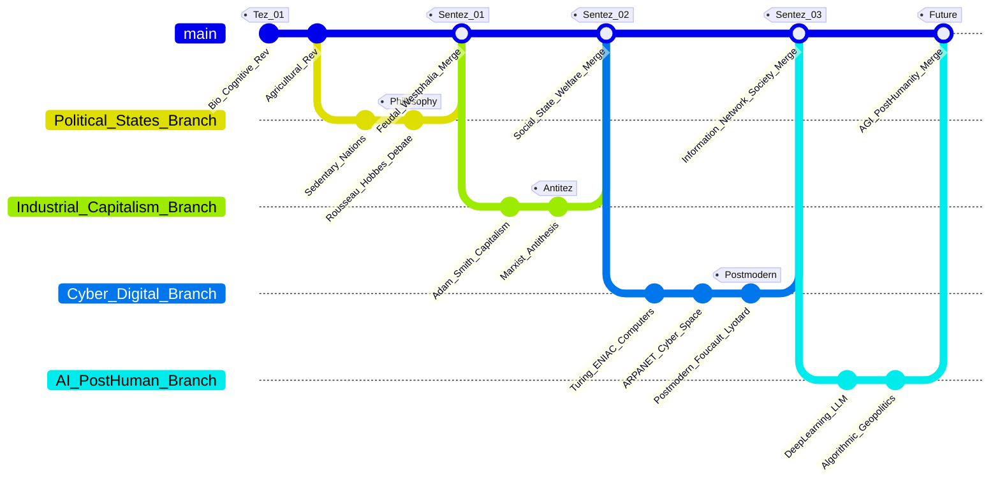

Dialectical World Engine: GitHub Flow Visualizer
> **Insanlık Tarihinin Felsefi, Sosyolojik, Ekonomik & Siber Kırılma Haritası**  
> *A Git-Flow representation of historical, philosophical, and technological paradigms from antiquity to the post-human AI horizon.*
---
📄 Overview
The Dialectical World Engine maps human history not as a linear sequence of isolated events, but as a continuous series of dialectical paradigm shifts. By mapping historical progression onto the Git Version Control Workflow, complex socio-philosophical transformations are visualised through code repository mechanics:
`main` Branch (Thesis / Tez): The established socio-political order, institutional baseline, or dominant ontological status quo.
`feature` Branches (Antithesis / Antitez): Revolutionary disruptions, philosophical counter-arguments, socio-economic crises, or emerging technologies.
`merge` Commits (Synthesis / Sentez): Historical resolutions resulting in a new systemic equilibrium (which subsequently becomes the next baseline thesis).
---
📊 Interactive Git-Flow Diagram
Below is the ASCII-verified Mermaid.js graph illustrating the structural evolution of human civilisations across five major epochs:

---
🌌 Multi-Disciplinary Node Breakdown
1. Pre-State & State Formation (Biological & Philosophical Origins)
Biological / Anthropological (MÖ 70.000 - MÖ 10.000): Homo sapiens' Cognitive Revolution enabled abstract language, shared mythology, and large-scale group cooperation beyond Dunbar's number.
State of Nature Debate (17th–18th Century):
Jean-Jacques Rousseau (Thesis): Human nature is inherently peaceful ("noble savage"); inequality and moral corruption stem from private property ($P$).
Thomas Hobbes (Antithesis): Human nature is naturally competitive and chaotic ("Homo homini lupus"); without a sovereign Leviathan, life is "solitary, poor, nasty, brutish, and short."
Westphalian Synthesis (1648): Sovereign nation-states institutionalised boundaries, formalised legal monopolies on violence, and established international public law.
2. Modernity, Industrialization & Political Economy
Adam Smithian Capitalism (1776): Division of labour, free markets driven by the "invisible hand," and the rise of bourgeois property relations.
Marxist Dialectical Materialism (1848): The conflict between productive forces ($F$) and relations of production ($R$) triggers class struggles between the bourgeoisie and proletariat.
Welfare State Synthesis (Post-WWII): Keynesian economics, institutionalised labour rights, social security, and social democracy merged capitalist market dynamics with state regulation.
3. Cybernetics, Digital Domain & Postmodernism
Computational Foundations (1936–1950): Turing's Universal Machine model formalised algorithmic computation, shifting power dynamics from physical to informational assets.
Postmodern Epistemology (1970s–1980s):
Jean-François Lyotard: Invalidation of grand meta-narratives (religion, progress, absolute truth).
Michel Foucault: Biopolitics and the shift from physical confinement to distributed digital panopticons.
Jean Baudrillard: Hyperreality and simulacra—where symbols replace underlying material reality.
Network Society Synthesis (2000s): Manuel Castells’ network paradigm; states treat cyberspace as the 5th domain of global conflict and surveillance.
4. Artificial General Intelligence & Post-Human Era
Large Language Models & Deep Learning (2017–Present): Transformer architectures automate cognitive labor, synthetic media generation, and algorithmic decision-making.
Algorithmic Singularity (AGI Horizon): Transitioning toward post-humanist paradigms—addressing existential risk ($X$-risk), neural-silicon integration, and super-intelligent alignment.
---
📐 Dialectical Evolution Matrix
Epoch / Era	Thesis (`main` branch)	Antithesis (`feature` branch)	Synthesis (`merge` commit)
Antiquity & Feudalism	State of Nature: Egalitarian hunter-gatherer bands; shared commons.	Agriculture & Property: Land enclosure, class division, Hobbesian state of war.	Westphalian Nation-State: Monopolised sovereign authority, legal borders, civil law.
Industrial Era	Laissez-Faire Capitalism: Free-market competition, industrial capital accumulation.	Dialectical Materialism: Proletarian revolution, collective ownership demands.	Social Welfare State: Keynesian regulation, social insurance, public-private hybrid systems.
Information Era	Geographic Sovereignty: Physical state borders, conventional bureaucracies.	Cyber Domain & Postmodernism: Borderless packet switching, decentralised networks, fragmented meta-narratives.	Digital Surveillance Society: Algorithmic Panopticon, cyber warfare, platform capitalism.
Post-Human Era	Anthropocentric Cognition: Human biological intelligence monopoly.	Autonomous AI & Agentic Models: Deep learning, autonomous cyber capabilities, algorithmic geopolitics.	AGI & Singularity Horizon: Post-scarcity economic frameworks, hybrid human-machine cognition.
---
📚 Academic Bibliography (APA 7th)
Baudrillard, J. (1981). Simulacres et Simulation. Éditions Galilée.
Bostrom, N. (2014). Superintelligence: Paths, Dangers, Strategies. Oxford University Press.
Castells, M. (1996). The Rise of the Network Society. Blackwell Publishers.
Foucault, M. (1975). Surveiller et punir: Naissance de la prison. Gallimard.
Hegel, G. W. F. (1807). Phänomenologie des Geistes. Joseph Anton Goebhardt.
Hobbes, T. (1651). Leviathan or The Matter, Forme and Power of a Common-Wealth Ecclesiasticall and Civil. Andrew Crooke.
Lyotard, J.-F. (1979). La Condition postmoderne: rapport sur le savoir. Éditions de Minuit.
Marx, K. (1867). Das Kapital: Kritik der politischen Ökonomie. Verlag von Otto Meissner.
Rousseau, J.-J. (1755). Discours sur l'origine et les fondements de l'inégalité parmi les hommes. Marc-Michel Rey.
Smith, A. (1776). An Inquiry into the Nature and Causes of the Wealth of Nations. W. Strahan.
Turing, A. M. (1950). Computing Machinery and Intelligence. Mind, 59(236), 433–460.
Zuboff, S. (2019). The Age of Surveillance Capitalism. PublicAffairs.
---
🛠️ Usage & Integration
To embed and edit this interactive model in web environments:
Import Tailwind CSS and Mermaid.js (v10+).
Render the `gitGraph` text inside a `<div class="mermaid">` element.
Bind custom click listeners to commit labels for dynamic detail inspection.
```html
<script src="https://cdn.jsdelivr.net/npm/mermaid@10/dist/mermaid.min.js"></script>
<script>
    mermaid.initialize({ startOnLoad: true, theme: 'dark' });
</script>
```
